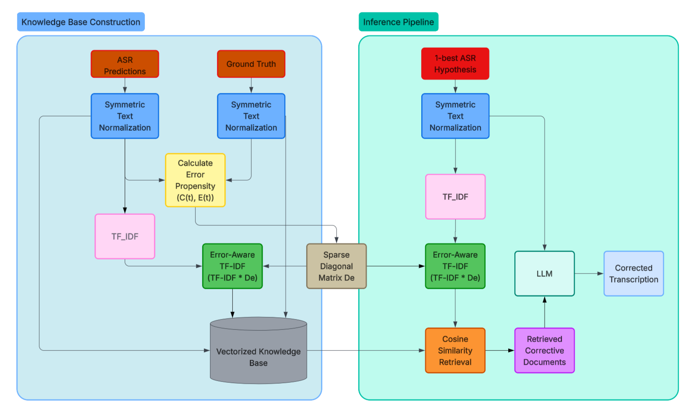

# ErrorAware-RAG-ASR-Corrector

[](https://arxiv.org/abs/2606.24915)
[](https://www.python.org/downloads/)
[](https://opensource.org/licenses/MIT)

**Official Code Repository for the paper:**
*"Error-Aware TF-IDF Retrieval-Augmented Generation for ASR Error Correction"*

This repository contains the complete inference and evaluation pipeline for a highly efficient, purely lexical error-aware framework designed to explicitly resolve phonetic and loop hallucinations in Automatic Speech Recognition (ASR) systems. 

## ✨ Key Features
*   **Symmetric Text Normalization:** A robust preprocessing pipeline symmetrically applied to both the external knowledge base and online inference queries to mitigate morphological mismatch and ASR loop hallucinations.
*   **Error-Aware TF-IDF Retrieval:** Replaces standard TF-IDF by constructing a sparse diagonal penalty matrix based on historical errors, dynamically assigning distinct weights to force the system to retrieve corrective context.
*   **Low-Resource Focus:** Specifically optimized and evaluated on the Persian subset of the Google FLEURS dataset.
*   **High Performance:** Achieves a Word Error Rate (WER) reduction from 23.06% to 18.83% and increases the Error-Aware Hit Rate (EA-HR) from 53.7% to 90.9% using Whisper large-v3-turbo and Gemini 2.0 Flash-Lite.

## 🧠 System Architecture

*Figure 1: Overall architecture of our proposed framework for Knowledge Base (KB) construction and inference. It introduces two computationally free modifications: parallel preprocessing via Symmetric Text Normalization and a novel Error-Aware TF-IDF retrieval algorithm.*

## 📁 Repository Structure
Based on the provided codebase structure, the repository is organized as follows:

*   **`configs/`**
    *   `config.yaml`: Configuration settings for paths, LLM parameters, and retrieval weights.
*   **`data/`**
    *   **`processed/`**
        *   `final_test_metrics.csv`: The final evaluated output containing WER scores.
        *   `fleurs_fa_rag_clean.csv`: The pre-cleaned knowledge base.
        *   `qualitative_comparison.csv`: Generated output comparisons.
    *   **`raw/`**
        *   `fleurs_fa_rag_database.csv`: The raw reference data.
        *   `fleurs_fa_test.csv`: The raw baseline Whisper predictions.
*   **`models/`**
    *   `error_aware_tfidf_artifacts.joblib`: Serialized sparse matrices for the proposed algorithm.
    *   `standard_tfidf_artifacts.joblib`: Serialized matrices for the baseline retriever.
*   **`scripts/`**
    *   `build_vector_db.py`: Compiles the knowledge base and trains the error-aware matrices.
    *   `evaluate_results.py`: Calculates the final Word Error Rate (WER).
    *   `predict.py`: Single-shot inference script for developer testing.
*   **`src/`**
    *   `llm_inference.py`: Handles API connectivity and LLM generation.
    *   `metrics.py`: Contains scoring functions for evaluation.
    *   `normalization.py`: Implements the Symmetric Text Normalization module.
    *   `retrieval.py`: Implements the core Error-Aware TF-IDF algorithm.
*   **`main.py`**: The core batch inference engine.
*   **`requirements.txt`**: Project dependencies.

## 🚀 Quick Start

### 1. Installation
Clone the repository and install the dependencies listed in `requirements.txt`:
```bash
git clone [https://github.com/YOUR_USERNAME/ErrorAware-RAG-ASR-Corrector.git](https://github.com/YOUR_USERNAME/ErrorAware-RAG-ASR-Corrector.git)
cd ErrorAware-RAG-ASR-Corrector
pip install -r requirements.txt
```
### Usage Pipeline
Reproduce the paper's full evaluation pipeline by executing the provided scripts:

```bash
# Step 1: Compile the Knowledge Base and train the Error-Aware TF-IDF models
python scripts/build_vector_db.py

# Step 2: Run the Batch LLM Inference Engine
python main.py

# Step 3: Calculate the strict Word Error Rate (WER)
python scripts/evaluate_results.py
```

## 📄 Citation

If you find this framework useful in your research, please cite the preprint authored by Mohammad Aref Jafari-Raddani:

```bibtex
@misc{jafariraddani2026errorawaretfidfretrievalaugmentedgeneration,
      title={Error-Aware TF-IDF Retrieval-Augmented Generation for ASR Error Correction}, 
      author={Mohammad Aref Jafari-Raddani},
      year={2026},
      eprint={2606.24915},
      archivePrefix={arXiv},
      primaryClass={cs.CL},
      url={[https://arxiv.org/abs/2606.24915](https://arxiv.org/abs/2606.24915)}, 
}
```
